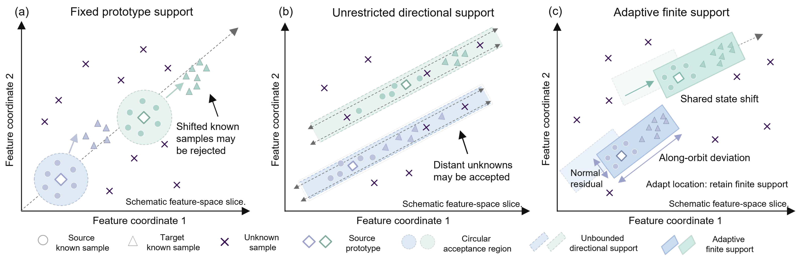
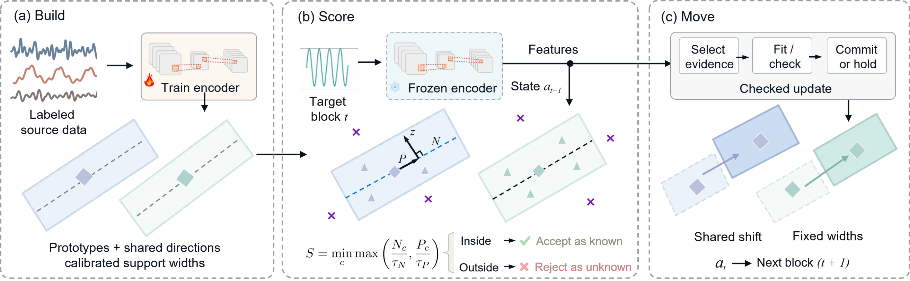
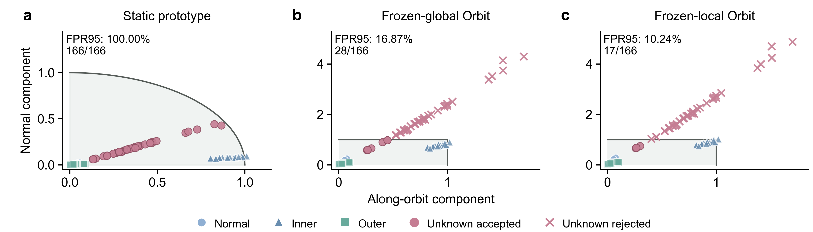

# OrbitFD: Finite-Support Prototype Orbits for Open-Set Fault Diagnosis

<p align="center">
  <a href="README.md"><b>English</b></a> | <a href="README_zh.md"><b>简体中文</b></a>
</p>

<p align="center">
  
  
  
  
</p>

Official PyTorch implementation of **"OrbitFD: Finite-Support Prototype Orbits for Open-Set Fault Diagnosis"**.

**OrbitFD** is a lightweight, geometrically bounded framework for open-set machinery fault diagnosis under unseen operating conditions (rotational speed and load shifts). Instead of updating neural network weights on unlabeled target streams—which risks severe contamination when unknown faults emerge—OrbitFD freezes a compact source-trained encoder, bounds known-class support in both **normal** and **along-orbit** feature components, and causally tracks operating-condition drift through a shared **two-dimensional deployment state**.

---

## Motivation & Method Overview

<p align="center">
  
</p>

Operating-condition changes and unseen fault categories can both displace vibration features away from their source distributions:
- **Compact isotropic supports** around fixed prototypes inadvertently reject known faults shifted by speed or load *(a)*.
- **Unbounded directional subspaces** tolerate condition variation but extend indefinitely along those directions, admitting distant unknown faults *(b)*.
- **OrbitFD** models each known class with a **finite-support prototype orbit** whose location translates via a shared low-dimensional state $a \in \mathbb{R}^r$ while preserving its calibrated widths and pairwise class geometry *(c)*.

<p align="center">
  
</p>

### Core Formulation

1. **Shared Within-Class Variation Basis (Source-Only):**  
   Given frozen source-standardized features $z \in \mathbb{R}^D$ ($D=64$) with class prototypes $\mu_c$, within-class scatter $S_w$, and between-class prototype scatter $S_b$, OrbitFD extracts the top-$r$ ($r=2$) orthonormal eigenvectors $U \in \mathbb{R}^{D \times r}$ of:
   $$A = \frac{S_w}{\operatorname{tr}(S_w)} - \kappa \frac{S_b}{\operatorname{tr}(S_b)}, \qquad B = U \operatorname{diag}(\sigma), \quad \sigma_j = \sqrt{u_j^\top S_w u_j}.$$
   Under deployment state $a \in \mathbb{R}^r$, all prototypes translate in tandem as $\mu_c + B a$, strictly preserving pairwise contrasts $(\mu_c + B a) - (\mu_d + B a) = \mu_c - \mu_d$.

2. **Class-Consistent Finite Support:**  
   Each feature $z$ is orthogonally decomposed relative to candidate class $c$ into a state-invariant **normal residual** $N_c(z)$ and a state-dependent **along-orbit residual** $P_c(z, a)$:
   $$N_c(z) = \frac{\|(I - U U^\top)(z - \mu_c)\|_2}{\sqrt{D - r}}, \qquad q_c(z) = \operatorname{diag}(\sigma)^{-1} U^\top (z - \mu_c), \qquad P_c(z, a) = \frac{\|q_c(z) - a\|_2}{\sqrt{r}}.$$
   Using disjoint source-calibrated widths $(\tau_N, \tau_P)$, acceptance requires **both** constraints to hold for the **same** class $c$:
   $$s_c(z, a) = \max\left\{\frac{N_c(z)}{\tau_N}, \frac{P_c(z, a)}{\tau_P}\right\}, \qquad S(z, a) = \min_c s_c(z, a), \qquad \hat{y}(z, a) = \arg\min_c s_c(z, a).$$
   Every accepted region $\mathcal{A}_c(a) = \{z : N_c(z) \le \tau_N,\, P_c(z, a) \le \tau_P\}$ is provably bounded in $\mathbb{R}^D$.

3. **Causal Shared-State Adaptation:**  
   Unlabeled target streams are processed in chronological 32-window blocks:
   - **Predict first:** Block $\mathcal{B}_t$ is scored and recorded using prior state $a_{t-1}$ before any observation in $\mathcal{B}_t$ can affect the state.
   - **State-invariant evidence selection:** Samples satisfying $N_{\tilde{c}}(z) \le \tau_N$ and normal margin $M(z) \ge \gamma$ (including *context-deferred* samples) yield coordinate observations $o = q_{\tilde{c}}(z)$.
   - **Gated Huber IRLS commit:** Temporally separated fit ($\mathcal{F}_t$) and check ($\mathcal{C}_t$) halves undergo anchored Huber IRLS estimation; a bounded step $a^+$ is committed for block $t+1$ only when fit/check agreement, trust-region radius, drift innovation, and held-out Huber loss improvement all pass.

---

## Key Highlights

- **Strong Open-Set Benchmark Performance:** Evaluated across **27 leave-one-fault-out tasks** (9 task groups $\times$ 3 unknown settings $\times$ 3 seeds) on **JNU**, **HUST**, **CWRU**, and **SelfA** against 8 representative DG/OSR fault diagnosis baselines, OrbitFD achieves the **highest mean AUROC in 8 of 9 task groups**.
- **Controlled Mechanistic Attribution:** Fixed-feature scoring controls (`E2`) and frozen-vs-online ablations (`E3`) isolate representation quality, finite-support geometry, and online state tracking—showing that two-component finite support drives major unknown-rejection gains (e.g., lifting CWRU `T7` AUROC from `72.58%` to `91.36%` and halving FPR95 from `65.80%` to `36.52%` even at $a = 0$).
- **Edge-Ready CPU Efficiency:** Native deployment requires `< 70k` encoder parameters (`68,800` for 1-ch; `69,760` for 3-ch), `3,600` bytes for the frozen source bank, and `16` bytes for the deployment state, executing in **13.12–14.08 ms per 32-window block** (~1.2 ms online engine) on a single desktop CPU thread without GPU acceleration.

<p align="center">
  
</p>

---

## Repository Structure

```text
OribitFD/
├── orbitfd/                         # Core OrbitFD Python library (zero target-label leakage)
│   ├── __init__.py                  # Public API exports
│   ├── bank.py                      # Shared variation basis & finite-support calibration (OrbitBank, fit_bank)
│   ├── online.py                    # Causal shared-state engine with Huber IRLS & gates (OrbitOnline, OnlineConfig)
│   ├── encoders.py                  # Lightweight 1D ConvNet WaveEncoder & SourceClassifier
│   ├── metrics.py                   # Post-hoc open-set evaluation metrics (Known Acc, AUROC, AUPR, FPR95, OSCR)
│   └── stream.py                    # Chronological block-stream rollout & geometric controls
├── scripts/                         # End-to-end CLI workflows & benchmark reproduction tools
│   ├── demo_synthetic.py            # Standalone synthetic stream sanity check & counterexample demo
│   ├── download_cwru.py             # Official 48k CWRU .mat downloader with SHA-256 verification
│   ├── prepare_benchmarks.py        # Non-overlapping 6-role temporal split builder for JNU, HUST, and CWRU
│   ├── train_backbone.py            # Source-only encoder training & causal stream evaluation
│   ├── export_features.py           # Frozen feature & logit extraction from trained checkpoints
│   ├── fit_bank.py                  # CLI wrapper for source-only OrbitBank calibration
│   ├── run_stream.py                # Causal stream inference (online, frozen_local, frozen_global, static, ...)
│   ├── evaluate_e2_e3.py            # Fixed-encoder scoring controls (E2-A) & mechanistic ablations (E3)
│   └── benchmark_cpu_latency.py     # Single-thread CPU latency, memory footprint & FLOPs profiler (E4)
├── configs/                         # Protocol & online adaptation configurations
│   ├── default_online_config.json   # Fixed OnlineConfig parameters used across all 27 tasks
│   └── task_groups_27.json          # Specification of T1-T9 task groups and U1-U3 unknown settings
├── results/                         # Summary CSV tables corresponding to Tables II-VI & Section V-D
├── assets/                          # Method & diagnostic figures
└── tests/                           # Unit & protocol verification tests
```

---

## Installation & Quickstart

### 1. Environment Setup

Requires Python $\ge 3.10$ and PyTorch $\ge 2.2$:

```bash
git clone https://github.com/yxx-xjtu/OribitFD.git
cd OribitFD
pip install -r requirements.txt
pip install -e .
```

### 2. Verify Unit Tests & Run Synthetic Demo (No External Data Needed)

Run the test suite (verifies basis orthonormality, causal predict-before-update ordering, normal-residual state invariance, trust-region gating, parameter counts, and temporal split disjointness):

```bash
python -m unittest discover -s tests -v
```

Run the standalone synthetic open-set stream demo (~3 seconds on CPU):

```bash
python scripts/demo_synthetic.py --out results/demo
```

Profile single-thread CPU deployment latency and memory footprint:

```bash
python scripts/benchmark_cpu_latency.py --channels 1 --blocks 64 --repeats 3
```

### 3. Minimal Python API Usage

You can attach `OrbitFD` directly to features extracted from **any** frozen source-trained encoder:

```python
import numpy as np
from orbitfd import fit_bank, OrbitOnline, benchmark_metrics

# 1. Fit frozen prototype orbits & finite supports strictly on source data
#    z_train: [N_tr, 64], y_train: [N_tr] in {0..K-1}
#    z_cal:   [N_cal, 64], y_cal:  [N_cal] in {0..K-1}, cal_ctx: recording IDs [N_cal]
bank = fit_bank(
    z_train, y_train,
    z_cal, y_cal,
    rank=2,
    semantic_penalty=0.2,
    calibration_context=cal_ctx,
)

# 2. Causal block-wise online deployment on an unlabeled chronological stream
engine = OrbitOnline(bank)
scores, preds, decisions = [], [], []

for start in range(0, len(z_target_stream), 32):
    block = z_target_stream[start : start + 32]
    out = engine.step(block, adapt=True)   # Predicts with a_{t-1}, then proposes/checks a_t
    scores.append(out["score"].numpy())    # S(z, a_{t-1}); reject at fixed boundary if S > 1
    preds.append(out["forced_prediction"].numpy())
    decisions.append(out["label"].numpy()) # 0..K-1 accepted, -1 off-orbit unknown, -2 context-deferred

# 3. Post-hoc evaluation (ground-truth y_target uses 0..K-1 for known, -1 for unknown)
metrics = benchmark_metrics(y_target, np.concatenate(preds), np.concatenate(scores))
print(metrics)
```

---

## Reproducing the Bearing Benchmarks

### Public Dataset Preparation (`T1`–`T7`)

1. **CWRU (`T3`, `T6`, `T7`):** Automatically download and SHA-256 verify the 16 official 48 kHz drive-end & normal `.mat` recordings from the [CWRU Bearing Data Center](https://engineering.case.edu/bearingdatacenter):
   ```bash
   python scripts/download_cwru.py --out data/CWRU48_official
   ```
2. **JNU (`T1`, `T4`) & HUST (`T2`, `T5`):** Place the 12 raw JNU `.csv` files ([JNU-Bearing-Dataset](https://github.com/ClarkGableWang/JNU-Bearing-Dataset)) under `data/JNU` and/or the 70 raw HUST `.xls` files ([HUST Bearing Dataset](https://github.com/CHAOZHAO-1/HUSTbearing-dataset)) under `data/HUST`.
3. **Build Disjoint 6-Role Splits:** Partition source recordings into `Train/Val/Cal/Audit` (`60/15/15/10%`) and target recordings into `Dev/Eval` (`30/70%`) with 1,024-point boundary purging and SHA-256 overlap checks:
   ```bash
   python scripts/prepare_benchmarks.py \
       --cwru data/CWRU48_official \
       --jnu data/JNU \
       --hust data/HUST \
       --out prepared
   ```
   *(You may pass any subset of `--cwru`, `--jnu`, `--hust` to prepare individual benchmarks.)*

### Source Training, Online Stream Inference & Ablations

Train the source encoder (1,020 class-balanced source batches, 30 validation checks, macro-F1 + CE tie-break checkpoint selection), calibrate `OrbitBank`, and evaluate on chronological 32-window target streams:

```bash
python scripts/train_backbone.py \
    --prepared prepared \
    --task-id T3-U1 \
    --seed 0 \
    --out runs/T3-U1_seed0
```

Run the fixed-encoder alternative scoring rules (`MSP`, `Energy`, `Mahalanobis-LW`, `ViM`, `Static prototype`, `Online Orbit`) and `E3` geometric/state ablations (`Frozen-local`, `Frozen-global`, `Normal-only`, `Source-union`, `Ungated`) on the exact same frozen features:

```bash
python scripts/evaluate_e2_e3.py --run-dir runs/T3-U1_seed0 --pool eval
```

### Running on Custom Vibration Datasets (`.npz`)

Prepare disjoint `.npz` files with `x` (`float32`, `[N, C, 1024]`) and `y` (`int64`, `0..K-1` for source; `0..K-1` and `-1` for target evaluation):

```bash
# 1. Train source-only backbone
python scripts/train_backbone.py --train data/custom_train.npz --val data/custom_val.npz --out runs/custom/best.pt

# 2. Export frozen features
python scripts/export_features.py --checkpoint runs/custom/best.pt --input data/custom_train.npz --out runs/custom/train_feat.npz
python scripts/export_features.py --checkpoint runs/custom/best.pt --input data/custom_cal.npz   --out runs/custom/cal_feat.npz
python scripts/export_features.py --checkpoint runs/custom/best.pt --input data/custom_eval.npz  --out runs/custom/eval_feat.npz

# 3. Fit frozen OrbitBank and run causal online stream
python scripts/fit_bank.py   --fit runs/custom/train_feat.npz --cal runs/custom/cal_feat.npz --out runs/custom/bank.npz
python scripts/run_stream.py --bank runs/custom/bank.npz --target runs/custom/eval_feat.npz --mode online --block-size 32 --out runs/custom/eval_online
```

---

## Benchmark Summary

Each of the nine task groups comprises three independently trained leave-one-fault-out settings (`U1`–`U3`) and three random seeds ($n = 9$ runs per group). Full group-level, instance-level, scoring-control, ablation, and latency CSVs are provided in [`results/`](results/README.md).

| Group | Regime | Dataset | Source $\to$ Target Conditions | OrbitFD Known Acc ($\uparrow$) | OrbitFD AUROC ($\uparrow$) | OrbitFD AUPR ($\uparrow$) | OrbitFD FPR95 ($\downarrow$) |
| :--- | :--- | :--- | :--- | :---: | :---: | :---: | :---: |
| **T1** | Interpolation | JNU | `600, 1000 -> 800 rpm` | 99.34 ± 0.46 | **85.23 ± 7.35** | **53.84 ± 15.41** | **57.51 ± 20.99** |
| **T2** | Interpolation | HUST | `20, 40, 60, 80 -> 25..75 Hz` | 87.82 ± 6.81 | **70.54 ± 12.58** | **49.14 ± 15.25** | **79.16 ± 13.52** |
| **T3** | Interpolation | CWRU | `0, 1, 3 -> 2 HP` | **100.00 ± 0.00** | **99.74 ± 0.44** | **97.80 ± 3.65** | **0.17 ± 0.40** |
| **T4** | Extrapolation | JNU | `600, 800 -> 1000 rpm` | **97.10 ± 3.37** | **87.50 ± 4.24** | **56.22 ± 14.48** | **58.75 ± 23.28** |
| **T5** | Extrapolation | HUST | `30..70 -> 20, 25 Hz` | **81.88 ± 4.51** | 57.58 ± 7.88 | 31.22 ± 4.37 | 97.77 ± 3.51 |
| **T6** | Extrapolation | CWRU | `0, 1, 2 -> 3 HP` | **100.00 ± 0.00** | **98.73 ± 1.97** | 92.09 ± 11.96 | 6.16 ± 18.02 |
| **T7** | Extrapolation | CWRU | `1, 2, 3 -> 0 HP` | 96.30 ± 7.23 | **91.36 ± 10.97** | 78.25 ± 26.05 | 36.52 ± 42.91 |
| **T8** | Cross-Speed | SelfA | `1200 -> 1800 rpm` | **85.18 ± 10.25** | **57.16 ± 15.66** | 31.06 ± 12.31 | 95.15 ± 5.90 |
| **T9** | Cross-Speed | SelfA | `1800 -> 1200 rpm` | **85.70 ± 5.15** | **74.25 ± 13.08** | **44.81 ± 20.00** | 89.08 ± 13.43 |

*(Bold entries denote the best group mean among all nine evaluated methods in Tables II–IV.)*

---

## Citation

If you find this repository or **OrbitFD** useful in your research, please consider citing:

```bibtex
@misc{yu2026orbitfd,
  title        = {OrbitFD: Finite-Support Prototype Orbits for Open-Set Fault Diagnosis},
  author       = {Yu, Bowen and Pang, Haoyang and Kong, Shaocheng and Zhu, Jingyi and Liao, Qifan and Yang, Wenxian and Zhang, Liuyang and Nandi, Asoke K. and Yan, Ruqiang},
  year         = {2026},
  howpublished = {\url{https://github.com/yxx-xjtu/OribitFD}}
}
```

## License

This project is released under the [MIT License](LICENSE).
