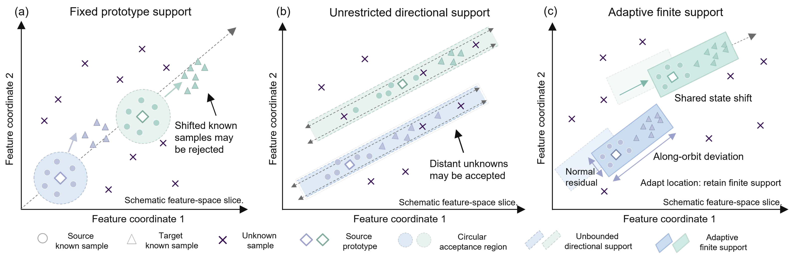
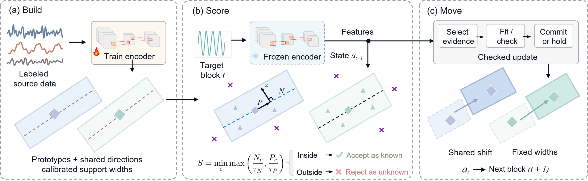

# OrbitFD：面向开集故障诊断的有限支持原型轨道框架

<p align="center">
  <a href="README.md"><b>English</b></a> | <a href="README_zh.md"><b>简体中文</b></a>
</p>

<p align="center">
  
  
  
  
</p>

本仓库为论文 **"OrbitFD: Finite-Support Prototype Orbits for Open-Set Fault Diagnosis"** 的官方 PyTorch 代码实现。

---

## 核心思想与方法概述

在变转速、变负载工业监测场景下，工况变化与未知新故障都会使振动特征偏离源域分布：
- **固定原型的紧凑各向同性支持域**容易将发生工况偏移的已知故障误拒识；
- **无界低维子空间**虽能容纳工况漂移，但在子空间方向上缺乏有限边界，容易接纳远端未知故障；
- **无约束测试时自适应（TTA）**在混有未知故障的无标签目标流上更新网络参数时，极易发生未知样本污染。

<p align="center">
  
</p>

**OrbitFD** 通过**冻结源域特征编码器 + 类别一致的有限支持原型轨道 + 因果共享状态自适应**解决上述矛盾：

1. **共享类内变化子空间构建（仅源域）：** 在标准化特征空间 $\mathbb{R}^{64}$ 中求解类内散布与类间原型散布之差的广义特征分解，提取二维正交基 $U \in \mathbb{R}^{64 \times 2}$ 与尺度矩阵 $B = U\operatorname{diag}(\sigma)$。部署状态 $a \in \mathbb{R}^2$ 对所有已知类原型施加同步平移 $\mu_c + Ba$，严格保持类间相对几何不变。
2. **类别一致的有限支持判据：** 将样本相对于候选类别 $c$ 正交分解为状态不变的**法向残差** $N_c(z)$ 与状态相关的**沿轨道残差** $P_c(z, a)$，通过嵌套 `max–min` 规则要求两个分量对**同一已知类别**同时满足源域校准边界 $(\tau_N, \tau_P)$，从而保证每个固定状态下的接纳域在全空间严格有界。
3. **因果共享状态在线更新：** 目标无标签数据流按 32 窗口分块顺序处理——先使用上一块已提交状态 $a_{t-1}$ 完成当前块预测并锁定输出，再通过法向边界门控筛选证据、前后半块时序切分、Huber IRLS 稳健位置估计、信任域与留出集增益检验决定是否为下一块更新 $a_t$，全程不修改任何神经网络权重。

<p align="center">
  
</p>

---

## 主要结果与亮点

- **全面的开集基准验证：** 在 **JNU**、**HUST**、**CWRU** 三个公开轴承数据集与自建实验台 **SelfA** 上构建 9 个任务组（涵盖内插 `T1–T3`、外推 `T4–T7`、跨转速迁移 `T8–T9`）、共 **27 个留一未知故障任务 × 3 随机种子**，与 8 种代表性基线方法对比，OrbitFD 在 **9 个任务组中的 8 个取得最高平均 AUROC**。
- **严谨的机制解耦分析：** 固定特征跨评分器对照（`E2`）与冻结几何 vs 在线状态消融（`E3`）表明，双分量有限支持几何是拒识性能提升的核心结构来源（例如在 CWRU `T7` 上，仅靠零状态冻结轨道几何即可将静态原型的 AUROC 从 `72.58%` 提升至 `91.36%`，FPR95 从 `65.80%` 降至 `36.52%`）。
- **极致的边缘 CPU 部署效率：** 部署编码器参数量不足 `70k`（单通道 `68,800` / 三通道 `69,760`），源域原型库仅占 `3,600` 字节，共享状态仅占 `16` 字节；在普通桌面级单线程 CPU（无 GPU）上处理一个 32 窗口数据块仅需 **13.12–14.08 ms**（其中在线轨道引擎仅约 `1.2 ms`）。

---

## 快速开始

### 1. 安装依赖

```bash
git clone https://github.com/yxx-xjtu/OribitFD.git
cd OribitFD
pip install -r requirements.txt
pip install -e .
```

### 2. 单元测试与免数据集一键合成流演示

```bash
# 运行全部核心几何性质、因果防泄漏与划分不相交单元测试
python -m unittest discover -s tests -v

# 运行合成开集流演示与同轨道反例检验（无需外部数据，CPU 约 3 秒完成）
python scripts/demo_synthetic.py --out results/demo

# 本地单线程 CPU 延迟与 FLOPs 评测
python scripts/benchmark_cpu_latency.py --channels 1 --blocks 64 --repeats 3
```

### 3. 公开轴承数据集复现流程（JNU / HUST / CWRU）

```bash
# 自动下载并校验官方 CWRU 48k 16 个原始 .mat 文件
python scripts/download_cwru.py --out data/CWRU48_official

# 生成严格无重叠的 6 角色划分（Train/Val/Cal/Audit 60/15/15/10%，Dev/Eval 30/70%，边界双向清除 1024 点）
python scripts/prepare_benchmarks.py --cwru data/CWRU48_official --out prepared

# 源域训练 + OrbitBank 校准 + 因果分块在线评估（以 T3-U1 为例）
python scripts/train_backbone.py --prepared prepared --task-id T3-U1 --seed 0 --out runs/T3-U1_seed0

# 在完全相同的冻结特征上运行 E2 替代评分规则与 E3 消融对照
python scripts/evaluate_e2_e3.py --run-dir runs/T3-U1_seed0 --pool eval
```

完整结果汇总 CSV 表格见 [`results/`](results/README.md)，英文详细说明与 Python API 示例见 [`README.md`](README.md)。

---

## 引用格式

如果本代码对您的研究有所帮助，欢迎引用：

```bibtex
@misc{yu2026orbitfd,
  title        = {OrbitFD: Finite-Support Prototype Orbits for Open-Set Fault Diagnosis},
  author       = {Yu, Bowen and Pang, Haoyang and Kong, Shaocheng and Zhu, Jingyi and Liao, Qifan and Yang, Wenxian and Zhang, Liuyang and Nandi, Asoke K. and Yan, Ruqiang},
  year         = {2026},
  howpublished = {\url{https://github.com/yxx-xjtu/OribitFD}}
}
```

## 开源许可

本项目采用 [MIT License](LICENSE) 开源许可协议。
